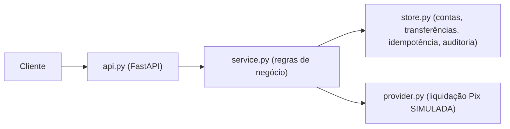
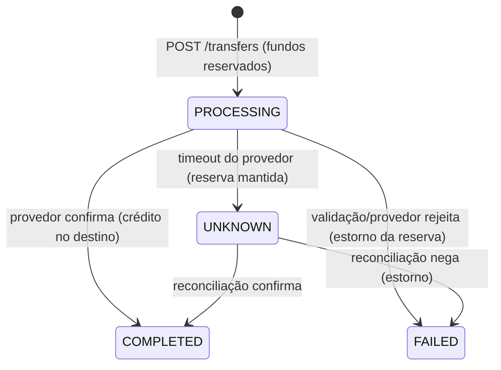

# Arquitetura — TechPix Transferências (simulado)

## Visão

API HTTP (FastAPI) em camadas, com armazenamento em memória thread-safe
(substituível por Postgres em produção) e provedor de liquidação **simulado**.

## Componentes

| Módulo | Responsabilidade |
|--------|------------------|
| `api.py` | Endpoints HTTP, validação de entrada (Pydantic), mapeamento de erros → status codes |
| `service.py` | Orquestra validações, idempotência, débito/crédito, estados e reconciliação |
| `store.py` | Estado em memória com `threading.Lock`; reserva de idempotência **atômica** |
| `provider.py` | Simula o provedor: confirma, rejeita ou estoura timeout (determinístico p/ testes) |
| `models.py` | Entidades e enums de estado |

## Decisões-chave (ADRs)

- [ADR-0001](adr/0001-stack-python-fastapi.md) — Python + FastAPI + store em memória.
- [ADR-0002](adr/0002-idempotencia-atomica.md) — Idempotência por **reserva atômica** da chave, não check-then-act.
- [ADR-0003](adr/0003-estados-e-reconciliacao.md) — Máquina de estados com `UNKNOWN` + reconciliação.

## Máquina de estados

## Concorrência e idempotência (RNF-01)

A chave de idempotência é **reservada atomicamente** dentro do lock do store
(`reserve_idempotency_key`): a primeira requisição grava a reserva e prossegue;
as demais recebem a transferência existente (ou `409` se o payload divergir).
O anti-padrão *check-then-act* (consultar e depois gravar em passos separados)
é exatamente o bug demonstrado no checkpoint `implemented`.

## Dinheiro

Valores sempre em **centavos (int)**. Float é proibido em valores monetários
(regra em `.agents/rules/dinheiro.md`).
